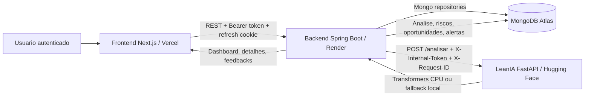

# Arquitetura - TOTVS Conversational Intelligence

## Visao geral

O projeto e dividido em tres servicos principais:

- `frontend`: aplicacao Next.js publicada na Vercel.
- `backend`: API Spring Boot publicada no Render.
- `ai-service`: LeanIA em FastAPI publicada no Hugging Face Spaces.

O MongoDB armazena usuarios, transcricoes, analises, alertas, refresh tokens e feedbacks da LeanIA.

## Diagrama

## Fluxos principais

### Autenticacao

1. O usuario envia e-mail e senha para `/api/auth/login`.
2. O backend aplica rate limit, valida `Origin/Referer` e autentica o usuario ativo.
3. O access token e retornado no corpo da resposta.
4. O refresh token e salvo em cookie `HttpOnly`, com hash persistido no MongoDB.
5. O frontend mantem o access token em memoria e renova a sessao via `/api/auth/refresh`.

### Criacao e analise de transcricao

1. O usuario cria uma transcricao no frontend.
2. O backend valida tamanho e metadados da transcricao.
3. A transcricao e criada como `PROCESSANDO`.
4. Um job assíncrono chama a LeanIA.
5. A LeanIA analisa sentimento, produtos, oportunidades, riscos e contexto adaptativo.
6. O backend salva `AnaliseResultado` e gera alertas.
7. O frontend consulta a transcricao e exibe a analise.

### Feedback adaptativo da LeanIA

1. O usuario marca uma analise como util ou informa ajuste.
2. O backend salva o feedback em `analise_feedbacks`.
3. O `LeanIALearningService` usa feedbacks recentes como contexto nas proximas analises.
4. A tela de detalhe mostra o historico de feedback da transcricao.

## Seguranca

- Access token curto assinado com HMAC SHA-256.
- Refresh token aleatorio, armazenado apenas como hash.
- Cookie `HttpOnly`, `Secure` e `SameSite` configuravel por ambiente.
- Rate limit em login, refresh e criacao de transcricoes.
- Validacao de origem em endpoints sensiveis de autenticacao.
- `X-Internal-Token` entre backend e LeanIA.
- `X-Request-ID` propagado entre frontend, backend e AI Service para rastreabilidade.
- `.env` e arquivos sensiveis ignorados pelo Git.

## Observabilidade

Toda requisicao recebe ou propaga um `X-Request-ID`.

No backend, o valor entra no MDC e aparece no padrao de log. Quando o backend chama a LeanIA, o mesmo request id e enviado para o AI Service.

No AI Service, o middleware tambem devolve `X-Request-ID` e inclui o valor nos logs Python.

## Limitacoes conhecidas

- O processamento assíncrono usa memoria do processo. Para producao mais robusta, o ideal e persistir uma fila de jobs no banco ou usar uma fila gratuita/auto-hospedada.
- O cache da LeanIA e em memoria e reinicia com o container.
- O plano gratuito do Render e do Hugging Face pode dormir apos inatividade.
- A exportacao PDF usa a impressao nativa do navegador para manter o projeto sem dependencias pagas.
